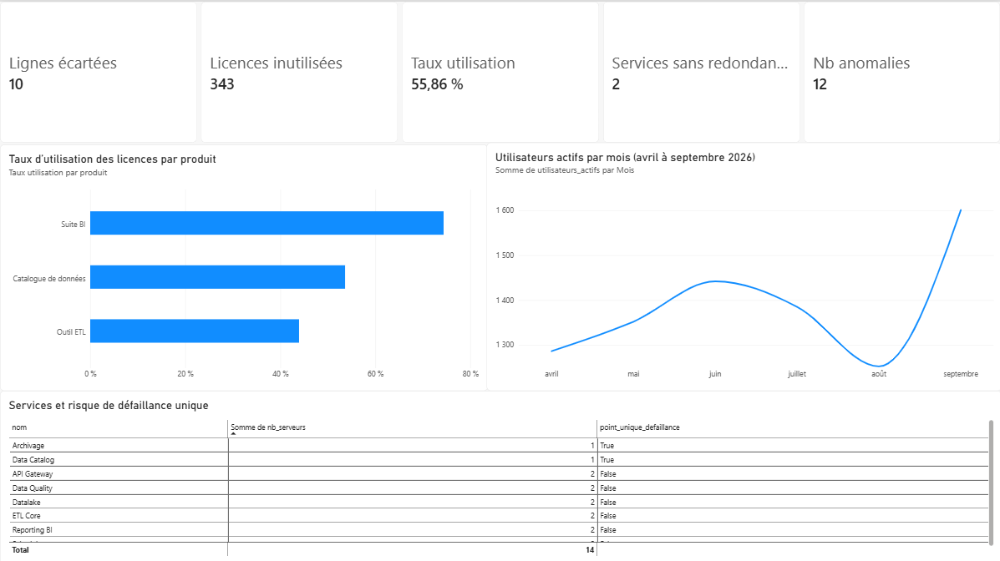
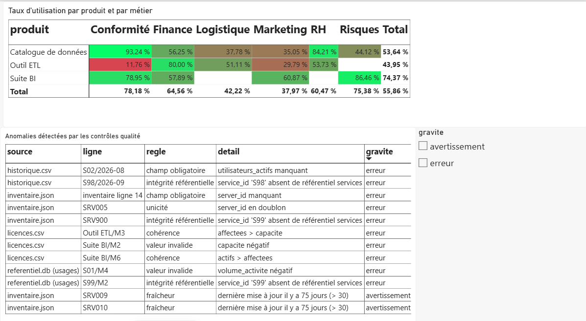

# TechScope

Mini-projet de pilotage d'un parc IT. Je pars de plusieurs sources de formats différents, je contrôle la qualité des données, puis je produis des indicateurs prêts à être mis dans un tableau de bord (Power BI).

**Les données sont entièrement fictives**, générées par `generate_data.py`. Les anomalies y sont mises volontairement pour tester les contrôles. Les dates de dernière mise à jour des serveurs sont calculées par rapport au jour où `generate_data.py` est lancé : le contrôle de fraîcheur donne donc le même résultat quelle que soit la date d'exécution.

## Pourquoi ce projet

Je voulais comprendre le parcours complet d'une donnée : récupérer des sources hétérogènes, vérifier qu'elles sont fiables, calculer des indicateurs, et automatiser le tout. Le contexte (un parc de serveurs, de services et de licences) est inspiré de ce qu'on peut rencontrer dans un service de pilotage informatique.

## Ce que fait le pipeline

```
inventaire.json ──┐
referentiel.db  ──┤
licences.csv    ──┼──> pandas ──> contrôles (DataCheck) ──> SQLite + CSV ──> Power BI
historique.csv  ──┘                        │
                                           └──> anomalies.csv + rapport.html
```

Une seule commande lance tout :

```
python generate_data.py   # crée des données fictives dans data/
python run_pipeline.py    # contrôles + exports dans output/
```

## Les contrôles qualité (`datacheck.py`)

| Règle | Exemple dans les données |
| --- | --- |
| Champ obligatoire | serveur sans identifiant, mois sans valeur |
| Unicité | serveur en doublon |
| Intégrité référentielle | service `S99` ou `S98` qui n'existe pas |
| Valeur invalide | capacité de licences ou volume d'activité négatif |
| Cohérence | plus de licences affectées que la capacité, plus d'actifs que d'affectées |
| Fraîcheur | serveurs non mis à jour depuis plus de 30 jours (avertissement, la ligne est gardée) |

Chaque ligne rejetée est écrite dans `output/anomalies.csv` avec la source, la règle et la raison. Les indicateurs sont calculés uniquement sur les données validées.

Une distinction importante : **un faible usage n'est pas une erreur de donnée**. Une licence très peu utilisée est un constat métier, elle reste dans les données et ressort dans le rapport à part.

## Indicateurs produits

- Serveurs par service, et services sans redondance (un seul serveur).
- Licences : taux d'affectation (affectées / capacité), taux d'utilisation (actifs / affectées), licences inutilisées.
- Évolution mensuelle des utilisateurs actifs.

Avec les données fictives actuelles (graine fixée à 42), le pipeline lit 113 lignes, détecte 12 anomalies et écarte 10 lignes. Trois constats ressortent :

1. Deux services n'ont qu'un seul serveur : **Data Catalog** et **Archivage**.
2. La suite BI est la mieux utilisée (74 % des licences affectées sont actives), l'outil ETL descend à 44 % et le catalogue de données à 54 %. Ça fait environ 340 licences payées mais inutilisées sur l'ensemble.
3. Le cas le plus faible est l'outil ETL pour la Conformité : 2 utilisateurs actifs sur 17 licences affectées (12 %).

## Dashboard Power BI

Les fichiers de `output/` sont faits pour être importés dans Power BI. La page 1 est une vue de pilotage (utilisation par produit, services sans redondance, évolution mensuelle). La page 2 détaille par métier et liste les anomalies.

Le fichier source du rapport est dans `docs/techscope.pbix`.

### Page 1 - pilotage



Vue d'ensemble : les indicateurs clés en haut (lignes écartées, licences inutilisées, taux d'utilisation global, services sans redondance, anomalies), le taux d'utilisation par produit, l'évolution mensuelle des utilisateurs actifs et la liste des services avec leur risque de défaillance unique.

### Page 2 - détail



Analyse détaillée : le croisement produit x métier du taux d'utilisation (en couleur, pour repérer les cas faibles comme l'outil ETL pour la Conformité à 11,76 %), et le tableau des anomalies détectées par les contrôles, filtrable par gravité.

## Structure

```
generate_data.py    données fictives avec anomalies volontaires
datacheck.py        module de contrôles qualité
run_pipeline.py     chargement, contrôles, indicateurs, exports
test_pipeline.py    vérifie que chaque anomalie est bien détectée
data/               sources générées
output/             résultats (CSV, techscope.db, rapport.html)
```

## Lancer le projet

```
pip install -r requirements.txt
python generate_data.py
python run_pipeline.py
python test_pipeline.py
```

## Limites et suite

- Données fictives : les chiffres ne représentent aucun vrai parc.
- Le seuil de faible usage (30 %) est arbitraire, il se règle dans `run_pipeline.py`.
- Pas encore de planification automatique : à brancher sur un cron ou le planificateur Windows.
- Prochaine étape : planifier l'exécution automatique du pipeline.
